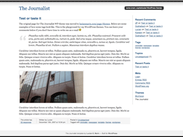

# The Journalist 1.9.9.9

Smart, minimal two-column WordPress theme designed for professional journalists by Lucian E. Marin (`http://lucianmarin.com/`).

- **Version**: 1.9.9.9 (September 9, 2009)
- **Compatibility**: Built for WordPress 2.3 – 2.8+
- **Layout**: Fixed-width (`911px`), two-column light theme with microformats support, widget-ready sidebar (`functions.php`), and templates for archives (`archive.php`, `archives.php`), links (`links.php`), pages (`page.php`), single posts (`single.php`), comments (`comments.php`), and search (`search.php`).

## Installation

1. Copy or upload the `wp-journalist` (or `journalist`) folder into your WordPress `wp-content/themes/` directory.
2. Log in to the WordPress administration panel and navigate to **Presentation** (or **Appearance → Themes**).
3. Select and activate **The Journalist**.

## Browser Support

Tested in:
- Firefox 1 / 2 / 3.5
- Opera 8 / 9 / 10
- Safari 2 / 3 / 4
- Internet Explorer 6 / 7 / 8
